<div align="center">

# ✱ JobScan AI

### Your resume goes in. Rated jobs and submitted applications come out.

**JobScan AI is a desktop app that searches about 13,700 company job boards, scores every match against your resume, and fills in and submits the applications you pick. It works in your own Chrome, and the AI runs on your own ChatGPT plan.**

No API key and no per-token bill. Search runs on your machine and costs no AI time at all.

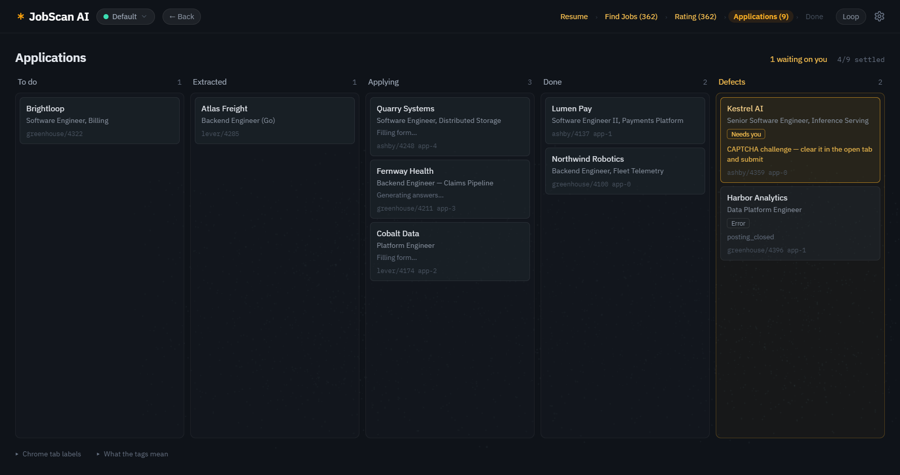

<sub>Every screenshot on this page comes from the real app, filled with sample data: a made-up candidate and made-up companies.</sub>

</div>

---

> [!WARNING]
> **JobScan AI sends real job applications.** A submitted application cannot be withdrawn. Before you let it submit:
>
> - read what it is about to send
> - start with a few jobs
> - turn on loop mode (unattended rounds) only once you trust your profile and answers
>
> You are responsible for what goes out in your name and for following each site's terms. Want to watch the whole flow first? Start the app with `JOB_AUTOMATOR_SUBMIT=0`. It fills every form and never presses Submit ([details](#try-it-without-sending-anything)).

---

## What it does

| | Step | What happens |
|:-:|---|---|
| **1** | **Read you** | You add a resume and a short profile: where you want to work, your work authorization, salary and a few preferences. |
| **2** | **Search** | An AI query writer turns your resume into 5 to 10 precise searches. Each one runs right away against a local copy of the job boards. |
| **3** | **Rate** | Every job found gets a score from 1 to 10 for *you*, with a one-line reason. Rating starts while the searches are still being written. |
| **4** | **Apply** | Pick the jobs you want, or keep the ones the app pre-selects (rated 8 or higher). Several agents work in parallel. Each one reads the form, writes the answers, fills them in Chrome, submits, and checks that the submission went through. |
| **5** | **Repeat** | Optional. Loop mode runs the whole cycle again on a schedule with a daily limit. It only looks at postings that are new since its last search. |

## Why it's different

- **🔑 Runs on the AI plan you already have.** Pick the engine in Settings: **ChatGPT (Codex)**, through your own Codex CLI signed in with your ChatGPT account, or **your own Claude Code**, signed in with your Claude plan. Either way there's no API key to paste and no metered bill, and nothing AI-related is bundled with the app.
- **🗄️ Search costs no AI time.** Job boards are downloaded once into a local SQLite full-text index. The AI writes the searches, and the searches themselves run locally.
- **💸 Built to spend as little AI as possible.** Each run caps how many jobs it rates and remembers what it already scored. Forms are filled by ordinary code first, and the AI is called only to fix what that code could not. [Here's every cost decision](#-built-to-save-cost).
- **🛡️ Honest about what it can't do.** A CAPTCHA, or an email code that never arrives, doesn't count as a failure. The app marks the job **Needs you** and leaves the tab open, one click from done.
- **📬 Reads email codes for you.** Greenhouse emails a security code after you submit. JobScan reads it from your mailbox over IMAP and types it in, even with several applications running at once.
- **🔁 Runs unattended if you want.** Loop mode has a daily limit, a minimum time between rounds, and a score threshold. It pauses a job board that keeps showing CAPTCHAs, waits out Codex usage limits, and never re-applies to a job whose submission might already have gone in.
- **🔒 Stored locally, sent only where it has to go.** Your resume, profile, history and mailbox settings live on your machine and are ignored by git. Two things leave it. Your resume, profile and the job postings go to the AI engine you chose (Codex under your ChatGPT account, or Claude Code under your Claude plan), so it can write queries, ratings and answers. Your answers and files go to the employers you apply to.

---

## Contents

- [Quick start](#quick-start)
- [How it's built](#how-its-built)
- [A tour of the app, step by step](#a-tour-of-the-app-step-by-step)
  - [1. Sign in](#1-sign-in) · [2. Resume & Profile](#2-resume--profile) · [3. Email for one-time codes](#3-email-for-one-time-codes-otp)
  - [4. Rebuild the job database](#4-rebuild-the-job-database) · [5. Find Jobs](#5-find-jobs-how-searches-are-written-and-run) · [6. Rating](#6-rating-how-every-job-is-scored)
  - [7. Applications](#7-applications-how-a-form-gets-filled-and-submitted) · [8. One-time codes, end to end](#8-one-time-codes-end-to-end) · [9. The repair agent](#9-the-repair-agent)
  - [10. Done & history](#10-done-history-and-application-records) · [11. Settings](#11-settings) · [12. Loop mode](#12-loop-mode) · [13. Let Claude Code drive JobScan](#13-let-claude-code-drive-jobscan)
- [Built to save cost](#-built-to-save-cost)
- [Built not to lose work](#-built-not-to-lose-work)
- [The `jobscan` CLI](#the-jobscan-cli)
- [Reference](#reference): data locations · environment variables · tests · layout · status

---

## Quick start

### Requirements

- **Windows 10/11** or **macOS** (Apple Silicon or Intel)
- **Node.js 22+**: <https://nodejs.org/>
- **Go 1.24+**: <https://go.dev/dl/> (macOS: `brew install go`). The `jobscan` CLI is built from source on your machine.
- **Python 3.10+**: <https://www.python.org/downloads/> (macOS: `brew install python`). It runs the form filler.
- **Google Chrome**: the filler drives your own Chrome. Set `JOB_AUTOMATOR_CHROME_PATH` if Chrome is not in the usual place.
- **An AI engine, either one:**
  - **Codex CLI** with a ChatGPT account that has Codex access: `npm install -g @openai/codex`. You sign in from inside the app.
  - **Claude Code**, installed and signed in once (`claude`, then `/login`). Choose it on the sign-in screen or in Settings.
  Searches, ratings and answers use that account's usage.

### Run it

```bash
git clone <this repository's URL> jobscan-ai
cd jobscan-ai/jobscan-app
npm install
npm run dev
```

`npm run dev` first runs `npm run setup` (`jobscan-app/scripts/setup.mjs`), which:

1. builds the `jobscan` CLI from `jobscan/` into `jobscan/jobscan` (`jobscan.exe` on Windows),
2. creates `jobscan/.venv` and installs `jobscan/requirements.txt` into it,
3. checks that Chrome is installed.

Each step is skipped when it is already up to date, so later starts are quick. Run `npm run setup` on its own to see every step.

### First run

1. **Pick your AI and sign in** when the app asks: Codex (sign in with ChatGPT) or your own Claude Code.
2. **Add your resume and profile.** That means target locations, work authorization, and the answers application forms ask for. The target location decides which markets the searches cover.
3. **Find jobs.** The first database build downloads postings from about 13,700 public job boards into `jobscan/jobs.db`. It takes a while, and the database grows to a few GB.
4. **Rate, pick and apply.** The app opens Chrome with its own profile (remote debugging on port 9222) and fills each form. Applications that need a CAPTCHA solved or other human input are left for you.

### Try it without sending anything

To watch the whole flow without sending anything, start the app with `JOB_AUTOMATOR_SUBMIT=0`. Every form is filled, and none is ever submitted.

```powershell
# Windows (PowerShell)
$env:JOB_AUTOMATOR_SUBMIT = "0"
npm run dev
```

```bash
# macOS / Linux
JOB_AUTOMATOR_SUBMIT=0 npm run dev
```

---

## How it's built

JobScan AI is three programs, each written in the language that suits its job, coordinated by an Electron app.

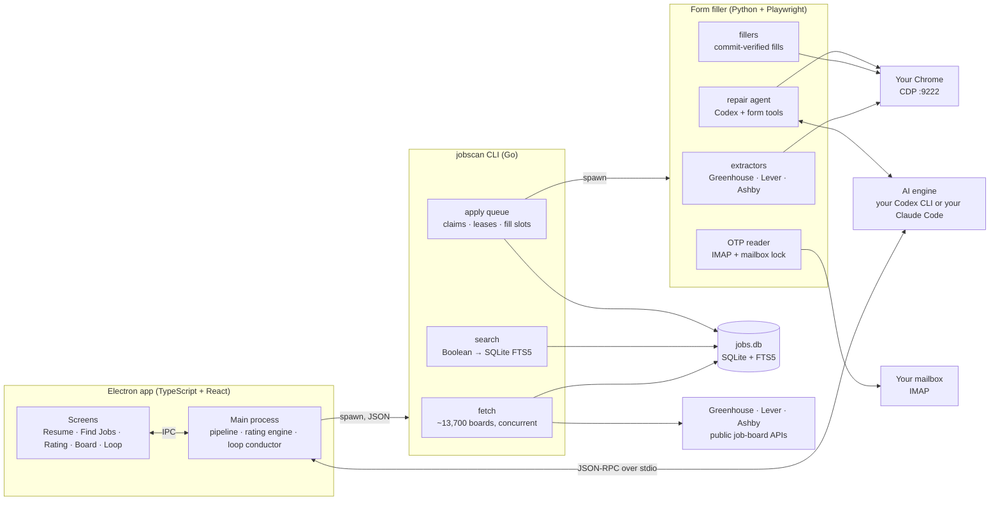

| Part | Language | Why that language |
|---|---|---|
| **Desktop app** (`jobscan-app/`) | TypeScript, Electron, React, Tailwind | One codebase for Windows and macOS. A real window, not a terminal, because applying is something you watch: a board, open tabs, a "needs you" queue. |
| **`jobscan` CLI** (`jobscan/cmd`, `jobscan/internal`) | Go | Downloading about 13,700 boards is a concurrency problem: hundreds of requests in flight, written into SQLite as they arrive. Go does that in one static binary, and the CLI works without the app. |
| **Form filler** (`jobscan/job_application_automator`) | Python + Playwright over Chrome DevTools | Filling a form is browser automation. Playwright's Python API, attached to *your* Chrome over CDP, drives the three applicant-tracking systems with platform-specific code. |
| **AI** | Your Codex CLI, or your Claude Code | Behind one interface (`electron/ai-engine.ts`). Codex: `codex app-server` over JSON-RPC, one long-lived process, a fresh read-only ephemeral thread per task. Claude Code: one isolated, tool-less `claude -p` run per task. Neither is bundled. |

<details>
<summary><b>Why the app drives the Codex CLI instead of calling an API directly</b></summary>

- **No key and no meter.** Signing in with ChatGPT means the work counts against a plan you already pay for, with nothing extra to set up or bill.
- **One process, many threads.** `codex-client.ts` starts `codex app-server` once and keeps it running. Each query, rating batch or set of answers gets its own `thread/start` with `ephemeral: true`, `sandbox: "read-only"` and `approvalPolicy: "never"`, so no task ever sees another task's context. Turns run at `effort: "medium"` with `summary: "none"`, which skips paying for reasoning summaries nobody reads.
- **Your own Codex, found where npm put it.** Nothing is bundled: `codex-locate.ts` finds the native binary inside your global `@openai/codex` install (nested or flat npm layout) the way `codex.js` does, or uses the path you set in Settings. Keep it current with `npm install -g @openai/codex`.
- **No console flash on Windows.** The app runs the native `codex.exe` directly rather than through the `codex.js` wrapper or the `.cmd` shim, so its `windowsHide` setting takes effect. It also runs a new binary once in a worker thread first (`binary-warmup.ts`): an antivirus scan of a never-seen `codex.exe` froze the window for 11 seconds before this fix.

</details>

### The pipeline at a glance

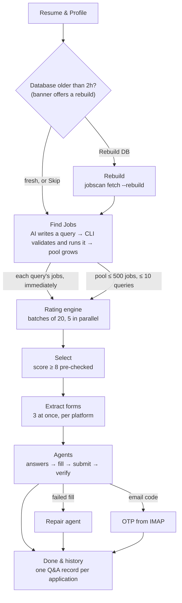

Every stage stores a hash of its inputs. If you go **Back** and **forward** with nothing changed, the stage replays its saved result instead of running again. If an input changes (your resume, profile, the Codex model or a prompt), that stage and everything after it are cleared and run fresh. ([More on this](#-built-to-save-cost).)

---

## A tour of the app, step by step

### 1. Sign in

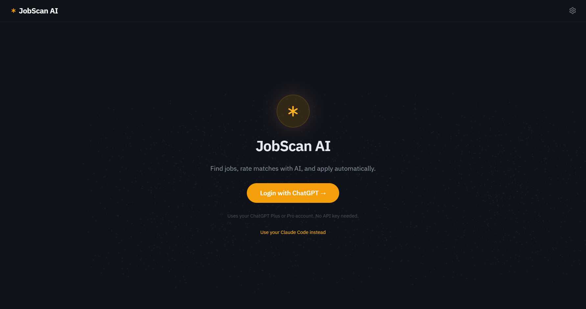

With **ChatGPT (Codex)**, click **Login with ChatGPT**. The app runs your Codex CLI's `codex login`, which opens the ChatGPT sign-in page in your browser. When you come back, the app checks for `~/.codex/auth.json` and moves on to your profile. If the Codex CLI isn't installed, the screen says how to install it (`npm install -g @openai/codex`).

With **your Claude Code**, there is nothing to sign in to here: JobScan uses the Claude Code already signed in on this computer. If it isn't signed in, the screen tells you to run `claude` in a terminal and type `/login`, then **Check again**. Each screen links to the other engine.

**How Claude Code answers.** Every AI call (one search, one batch of 20 ratings, one form's answers) runs your Claude Code once, headless, with the same prompt Codex gets. That run has no tools, no MCP servers, none of your settings, hooks, plugins or memory, no `@file` expansion and no saved transcript, in an empty private folder: it can only read the prompt and write a reply, which goes back to JobScan alone. Form repair (section 9) is off with this engine.

### 2. Resume & Profile

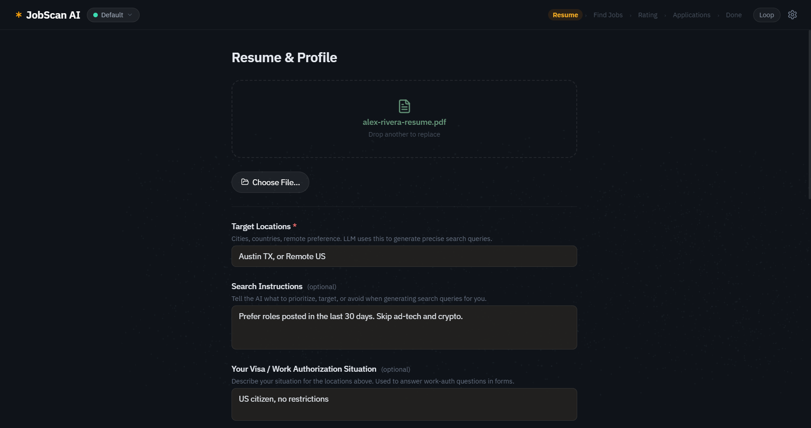

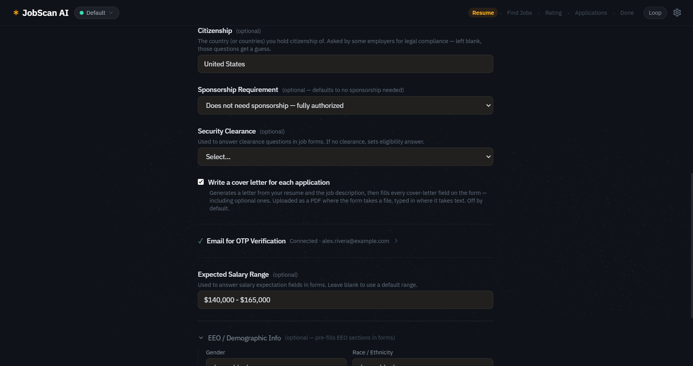

The profile is short, and every field has a specific use. Here is exactly where each one goes:

| Field | Required | Where it's used |
|---|:-:|---|
| **Resume** (PDF or TXT, drag and drop) | ✅ | Parsed to text locally (`pdf-parse`). It feeds the query writer, the rater and the answer writer. Names, email, phone, school and employer in your answers come from here. The file itself is uploaded wherever a form asks for a resume. |
| **Target Locations** | ✅ | Turned into **market IDs** and `--location` cities by the query writer, and compared against each job's location by the rater. A job in a city you didn't ask for and can't commute to scores **at most 4**. |
| **Search Instructions** | | Your own words, *followed precisely*. Instructions that limit the search ("only Greenhouse", "posted this week", "remote only") apply to **every** query. Instructions that add something ("also find ML infra roles") get their own query. The rater treats them as more important than its own reading of your resume. |
| **Visa / Work Authorization** | | Answers "Are you authorized to work in…?" questions. Also shown to the rater. |
| **Citizenship** | | Asked separately from work authorization on purpose: forms ask about the two separately, often for export-control compliance. |
| **Sponsorship Requirement** | | *Doesn't need* / *Might need in the future (e.g. OPT → H-1B)* / *Needs it now*. Answers sponsorship questions. If you need sponsorship and a posting says it doesn't sponsor, the job scores **at most 2**. A posting that says nothing about sponsorship is never marked down. |
| **Security Clearance** | | Answers clearance and eligibility questions. |
| **Write a cover letter for each application** | | Off by default. When on, it writes a 180–250-word letter from your resume and the job description. The letter is uploaded as a generated PDF where the form takes a file, and typed in where it takes text. Unfilled placeholders like `[Company]` are caught before anything is sent. |
| **Email for OTP Verification** | | See [section 3](#3-email-for-one-time-codes-otp). |
| **Expected Salary Range** | | Answers salary questions, and lowers a job's score only when the posting publishes a salary well below it. If left blank, forms get a default range. Number-only fields get one plain integer, converted if the question asks per month or in another currency. |
| **EEO / Demographic Info** | | Gender, race/ethnicity, veteran and disability status. These are used **only** to fill voluntary EEO sections, and each can be left blank. They are **deliberately never shown to the rater**: none of them says anything about job fit. |

Below the fields, **Find Matching Jobs →** starts a run. If the job database has never been built, or is more than two hours old, a banner at the top of this screen offers **Rebuild DB →** (or **Skip**, to search what you already have). Loop mode rebuilds at the start of every round by itself.

> **Profiles.** One person can keep several personas: for example "Backend, US" and "Data, EU". Each profile has its own resume, answers, pipeline state, applied history and OTP mailbox, and nothing is shared between them. Switch profiles from the chip next to the logo, and create them in [Settings](#11-settings).

### 3. Email for one-time codes (OTP)

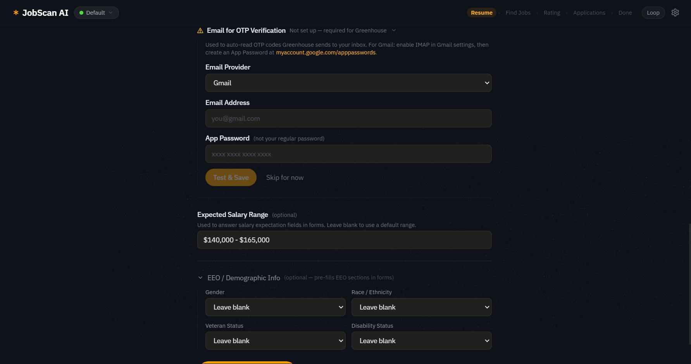

Greenhouse often protects its application form with an emailed **security code**: you press Submit, a code arrives in your inbox, and you type it in. JobScan handles that step for you over **IMAP**:

1. Pick a provider (**Gmail**, **Outlook / Hotmail**, **Yahoo Mail**, **iCloud Mail** or **Custom / Other** with your own host and port).
2. Enter your address and an **app password**. That's a special password your provider generates for one app, not your normal one. For Gmail: turn on IMAP, then create one at `myaccount.google.com/apppasswords`.
3. Click **Test & Save**. The app logs in once (`imap_setup_check.py`) and saves the settings only if the login works.

The settings are saved to `jobscan/.job-automator/secrets/imap_config.json`, on your machine only. How the code is matched to the right application, even with five running at once, is covered in [section 8](#8-one-time-codes-end-to-end).

The settings are stored as plain JSON, so treat that folder like any other secrets folder. (`jobscan/setup_gmail_oauth.py` sets up read-only Gmail OAuth for the command-line `jobscan apply submit --otp-mailbox gmail:…` path only. The app itself uses the IMAP settings above.)

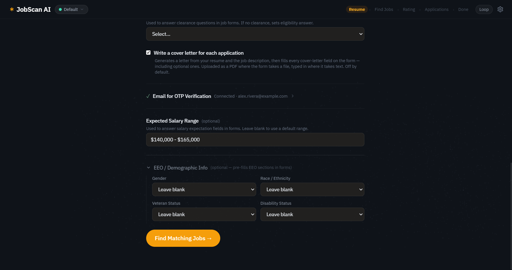

### 4. Rebuild the job database

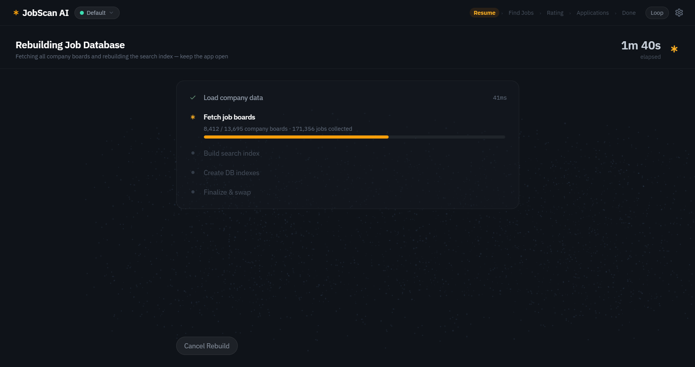

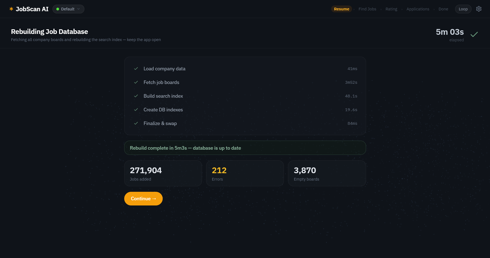

All the searching happens against **`jobs.db`**, a local SQLite database built by `jobscan fetch --rebuild`. It works through the five stages shown on screen:

| Stage | What happens |
|---|---|
| **Load company data** | Reads the board lists shipped in `jobscan/data/`: about **7,300 Greenhouse**, **3,600 Ashby** and **2,800 Lever** company boards, each one already checked to answer. |
| **Fetch job boards** | Downloads every board from its public JSON API at once: **240** Greenhouse, **160** Ashby and **80** Lever requests in flight (`internal/config`). Each request has a 12-second timeout. A `429` or `5xx` is retried after 0.5 s and again after 1 s; a `404` is never retried. Postings are cleaned up (HTML stripped, fields normalized) and written to SQLite as they arrive. |
| **Build search index** | Builds an **FTS5** full-text index over title, description, company, location, department, type and platform. It's built *once*, after all rows are in, instead of being updated row by row, which keeps the bulk load fast. |
| **Create DB indexes** | Adds ordinary indexes for date, company and market lookups. |
| **Finalize & swap** | The new database is built in a temporary file (`.jobs.db.rebuild-<time>.tmp`) and **swapped in only if every stage succeeded**. A cancelled or failed rebuild leaves your current database untouched. Leftover temp files older than 15 minutes are removed on the next run. |

<details>
<summary><b>Engineering notes on the database</b></summary>

- **Rebuild mode vs normal mode.** During a rebuild nothing else reads the temporary file, so it's written with `journal_mode=OFF`, `synchronous=OFF`, a 512 MB page cache and 2 GB of memory-mapped I/O. The live database runs in WAL mode, so searches and the apply queue can read and write at the same time.
- **Tokens that keep `C++` intact.** The FTS tokenizer treats `+ # - . @` as part of a word. So `C++`, `C#`, `.NET` and `node.js` are searchable terms instead of turning into `C`, `NET` and `node`.
- **Markets are worked out once, at fetch time.** Every posting is classified into **markets**: 55 countries, `remote-global`, and 8 regions (`north-america`, `europe`, `eu`, `nordics`, `baltics`, `apac`, `latam`, `emea`). The result is stored in a `job_markets` table. Boards write locations inconsistently ("NYC", "New York, NY", "US-Remote"), so a lookup into pre-computed markets is much more reliable than matching the location text when you search.
- **Two-hour cache.** A plain `jobscan fetch` skips boards fetched in the last 2 hours. The app considers a database older than 120 minutes stale and offers to rebuild it.

</details>

### 5. Find Jobs: how searches are written and run

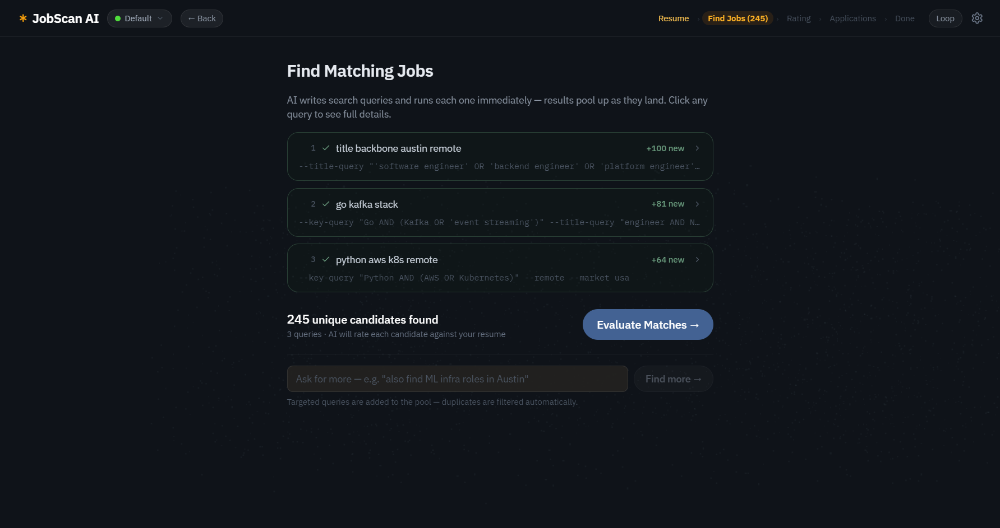

This is the core idea of JobScan: **the AI decides *what* to search for, and the search itself runs locally on the database.**

A Codex thread reads your resume, target locations and search instructions, and writes **one query at a time** as JSON (`{name, flags, description}`). The flags use the `jobscan search` syntax. The moment a query arrives, the app:

1. **Checks it by running it.** The CLI parses the flags and returns the *live match count*. Bad JSON, unknown flags or Boolean syntax errors go straight back to the model with the exact error message, so it can fix the query (up to 3 retries).
2. **Rejects useless queries.** `0` matches means "broaden it". Fewer than **40** matches means it's too narrow to deserve a slot, so the model gets **one** retry to widen it, and the second answer is accepted whatever it matches (a small platform or market may really be that thin). After 3 abandoned slots the run stops: a model failing that often is failing systematically.
3. **Runs it and adds the results to the pool.** It takes the top **100** by relevance, **deduplicated** (the same title at the same company counts once) and with **at most 3 per company**. Without that, one employer took 19 of 100 places in a measured search. Jobs you've already applied to are removed *before* they enter the pool, so they never cost a rating.
4. **Tells the model how it did.** The model learns how many **new** jobs the query actually added, not just how many it matched: a query matching 5,000 jobs can add zero if earlier queries already covered them. It also learns how many pool slots remain.
5. **Starts rating straight away.** The query's jobs go to the rating engine while the model writes the next query.

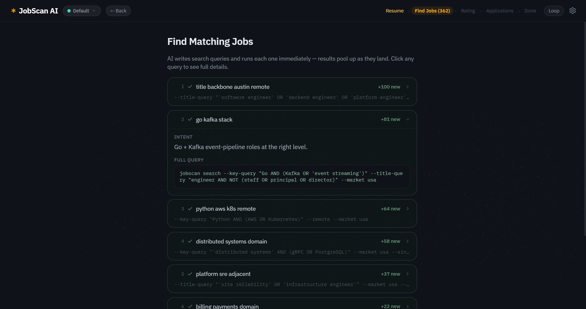

Click any card to see its **intent** and the full `jobscan search …` command. When the run finishes:

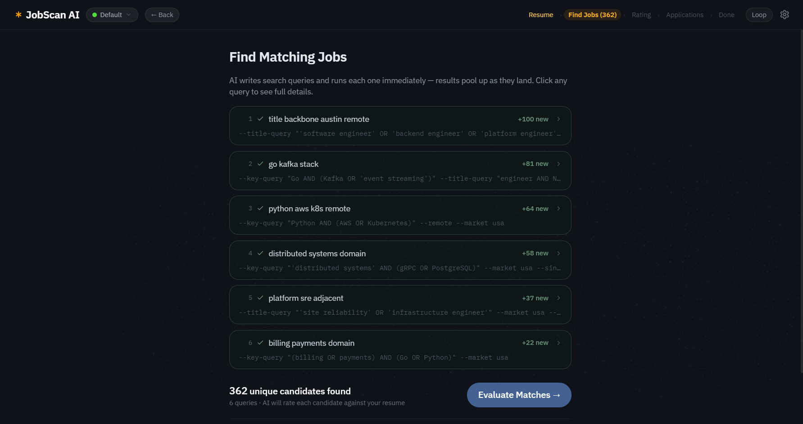

**Ask for more** (bottom of the screen): type a request like *"also find ML infra roles in Austin"*. The model writes 1 to 3 extra queries just for that request, each different from every earlier query. Duplicates are filtered out automatically, and the request is exempt from the pool limit, because a full pool shouldn't quietly swallow something you asked for.

<details>
<summary><b>The search language the model writes (and you can use yourself)</b></summary>

| Flag | Searches | Example |
|---|---|---|
| `--title-query` | job titles, Boolean | `"'backend engineer' OR 'platform engineer'"` |
| `--key-query` / `-Q` | descriptions, Boolean | `"Go AND (Kafka OR 'event streaming')"` |
| `--exclude-key-query` | descriptions, excluded | `"clearance OR embedded"` |
| `--exclude-title-phrase` | plain title substrings, excluded | `"Staff Software Engineer,Engineering Manager"` |
| `--market` | pre-classified markets | `usa,canada,remote-global` |
| `--location` | location text | `"Austin,Round Rock"` |
| `--remote` / `--hybrid` / `--onsite` | workplace type (at most one) | |
| `--since` / `--before` | posting date | `30d`, `2026-04-01` |
| `--platform`, `--company`, `--type`, `--department` | source filters | `--platform greenhouse` |

**Grammar:** `AND`, `OR`, `AND NOT` and nested parentheses. There's no implicit AND, so you write `Go AND Kafka`, not `Go Kafka`. Multi-word phrases go in quotes: `'distributed systems'`. A trailing `*` matches a prefix: `engineer*` finds engineer, engineers, engineering. All filters combine with AND.

**Spellings and plurals are handled automatically.** Across 271,700 real postings, *backend* appears 16,379 times, *back-end* 2,290 times and *"back end"* 238 times. *fullstack* appears only 646 times, against 6,091 for *full-stack*. Searching for one spelling would quietly miss most of the jobs. So the engine reads the index's own vocabulary (`fts5vocab`) and widens each term to the spellings and plurals that actually occur in your database. No hand-written synonym list is involved, and it works for any database.

</details>

<details>
<summary><b>Why the pool is a budget, not a goal</b></summary>

Every pooled job is read and scored by the rating model, so **the pool size is the rating bill**. A run stops at **500 jobs or 10 queries**, whichever comes first (`POOL_TARGET`). Past that point, another query adds marginal candidates at full token price, for a run that will apply to a few dozen jobs at most.

That's why the query writer is told to aim for **about 200 matches per query**. That's tight enough that almost everything it returns is on target, so all 100 pooled jobs are worth rating. Its other rules come from measured failures:

- **Pair a title with a stack.** For example `--title-query "engineer"` plus `--key-query "Kafka AND (Java OR Scala)"`.
- **Anchor generic noun lists.** In one measured case, a bare list of four generic nouns returned 46 engineering roles in its top 100. Adding `AND (engineer OR developer …)` raised that to 94 of 100.
- **Only add that anchor when a query matches more than about 1,000 jobs.** On smaller queries it can cut 3,259 matches down to 58.
- **Put `--type intern` on at most one query.** Title terms alone find 3,266 internships, while the type field (often left empty by boards) finds 845. Since filters AND together, putting it on every query would cap the whole pool at the smaller number.

</details>

### 6. Rating: how every job is scored

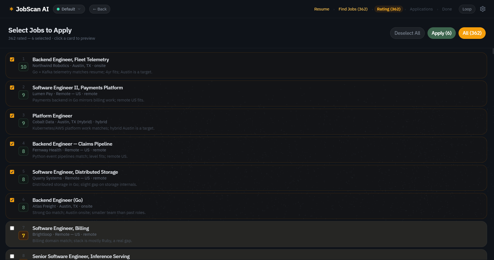

The **rating engine** runs in the background. It starts as soon as the first query adds jobs to the pool, so by the time you click **Evaluate Matches →** most of the jobs are already scored.

- **Batches of 20 jobs per Codex call**, with **5 calls running at once** by default (change it in Settings → *Rating Agents*).
- Each job is shown with its title, company, location, workplace type, employment type, posted salary (if any), and the **first 4,000 characters** of its description.
- Alongside it, a **candidate profile**: target locations, work authorization, sponsorship need, expected salary, clearance and your search instructions. It does **not** include your EEO answers.

<details>
<summary><b>The rubric the rater follows</b></summary>

Scores run from 1 to 10 for *this* candidate. `10` means right role, right level, reachable location and nothing disqualifying. `7–9` means a strong match with minor gaps, `4–6` a partial match, and `1–3` the wrong role or level, or a disqualifying condition. The factors are weighed in this order:

1. **Role and skills.** What the posting requires compared with what the resume shows. A technology listed once under "nice to have" counts for less than a responsibility built around it, and a high keyword count earns nothing.
2. **Seniority.** Years on the resume compared with the level asked for. Mismatches cost points in both directions.
3. **Location.** A city you can't reach caps the score at 4. A remote role satisfies any target inside the region it hires in. A posting with *no* location is not marked down.
4. **Sponsorship.** A posting that won't sponsor, for a candidate who needs it, is capped at 2. A posting that says nothing about sponsorship is never marked down.
5. **Salary.** Considered only when the posting publishes one *and* you set an expectation.
6. **Your search instructions** take priority over the rater's own reading of your resume.

The output is strict JSON: a score and a reason under 15 words for every job.

</details>

<details>
<summary><b>Why 4,000 characters of description, and not 800 or the whole thing</b></summary>

This was measured over 4,000 real postings. The median description is 4,963 characters long, and 87% have a *Requirements / Qualifications* section, starting at a median of character 2,033. An 800-character slice reached that section for only **15%** of jobs; for the rest, the rater was scoring mission statements and benefits. 4,000 characters reaches it for **89%**. Going to 6,000 would reach 97%, for 22% more tokens, so 4,000 is where extra length stops paying off. Per 500-job pool, that's about 0.55M input tokens (up from 0.19M), and the largest single call is about 23k tokens.

</details>

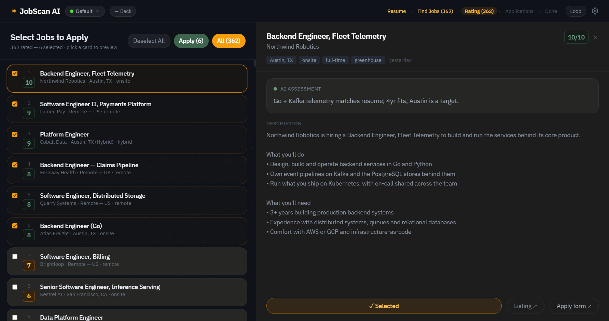

Click a card to read the full description beside the AI's reasoning. **Listing ↗** opens the posting, and **Apply form ↗** opens the form without submitting anything. Jobs rated **8 or higher are pre-selected**. Adjust the selection, then click **Apply (n)**.

### 7. Applications: how a form gets filled and submitted


The board shows the run as it happens. Each column is one step a person cares about:

| Column | Meaning |
|---|---|
| **To do** | Selected, not started yet. |
| **Extracted** | The form has been read, and the job is waiting for a free agent. |
| **Applying** | An agent is *generating answers* or *filling the form*. |
| **Done** | Submitted, and confirmed by the page itself. |
| **Defects** | **Needs you** (one step only a person can do is left, in the open tab), **Error** (failed, and the card says why) or **Skipped** (loop mode didn't finish this job). |

Here's what happens to each job, in order:

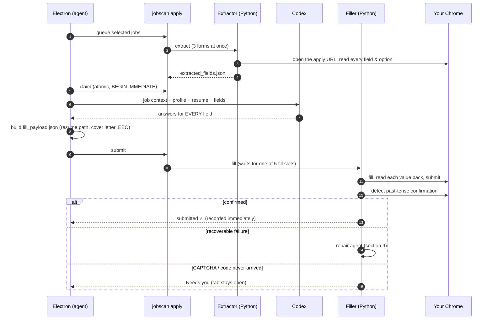

**Reading the form.** The platform-specific extractor opens the apply URL in your Chrome and records every field: its label, type, whether it's required, and its options. Forms are read one platform at a time, three at once. Long typeahead lists are sampled and marked `options_truncated`, so the answer writer knows the list isn't complete.

**Writing the answers.** One Codex call per job, with the job's title, company and description, your profile and resume, and the field list. The rules it must follow came from real mistakes:

- **Dropdown answers are copied character for character** from the listed options, and the closest *category* is allowed when your exact answer isn't listed ("Applied Mathematics" → "Mathematics").
- **Names are never approximated.** A school or employer that isn't in the list is never swapped for a similar-looking one. The model picks **Other** and types the real name in the follow-up box, or leaves the field empty. An empty answer is honest and you can fix it; a wrong school is a false statement that gets submitted.
- **Typeahead fields** (where only a sample of options was listed) get your real value, typed out exactly.
- **Location boxes** get the full "City, State, Country" form, because a bare "Birmingham" can match Birmingham, UK.
- **Number fields** get one plain number, never "$120k–140k" (a number field silently rejects that, leaving it blank).
- An answer set with **no answers at all** counts as a failed turn, not a hard form. It never gets filled from defaults alone.

**Filling the form.** The filler types, selects, clicks and uploads, then **reads every value back**: three Ashby comboboxes once reported success on values that never actually took. "Yes/No" answers to checkboxes go through one shared conversion (`answer_values.py`), because `bool("No")` is `True` in Python and once ticked a sponsorship box the candidate had answered "No" to.

**Checking it submitted.** Every platform uses one shared check (`submission_signals.py`): **only past-tense confirmation counts**, like "application submitted" or "your application has been received". The future-tense "will be submitted" doesn't count, and neither does a bare "submit". A missed confirmation would send a finished application to the repair agent, which would apply a second time. A false one would record an application that never went in.

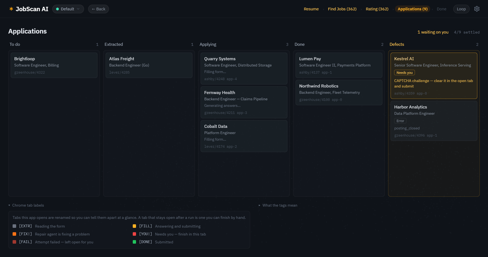

**You can tell the tabs apart.** Every automated Chrome tab gets a stage code and a coloured icon, so a strip of tabs reads like the board:

| Tab | Meaning |
|---|---|
| `[EXTR]` grey | Reading the form |
| `[FILL]` amber | Answering and submitting |
| `[FIX!]` orange | The repair agent is fixing a problem |
| `[YOU!]` red | **Needs you**: finish in this tab |
| `[FAIL]` dark red | The attempt failed, and the tab is left open for you |
| `[DONE]` green | Submitted |

In a normal run, successful tabs close and unsuccessful ones **stay open** so you can finish them by hand. In loop mode, every tab closes, because nobody is there to finish it.

<details>
<summary><b>"6 agents", "5 slots", "up to 9 tabs": how the numbers fit together</b></summary>

- **Payload agents (default 6, set in Settings).** These are concurrent workers in the app. Each one claims a job, asks Codex for answers and hands the filled payload to `jobscan apply submit`.
- **Fill slots (5, set in Go).** At most five jobs are *actively driving the browser* at once. A sixth submission waits for a slot. Jobs in the repair phase leave a `.recovery_active` marker and **don't count** against the five, because they mostly wait on the model, not the browser. A `filling` row untouched for 30 minutes is treated as dead and its slot is freed, so a crashed filler can never block the queue.
- **Loop runs use at most 5 agents.** A loop job has a fill deadline. A job waiting for a slot would use up that deadline without ever starting, so loop runs never have more agents than slots.
- **Up to 9 tabs** means six application agents plus three extractors.
- **Claims are atomic.** `apply claim` uses a `BEGIN IMMEDIATE` transaction, so two agents can never claim the same posting.

</details>

### 8. One-time codes, end to end

When five applications run at once, five security-code emails can arrive in the same inbox within seconds of each other. The OTP system makes sure each code goes to the right application:

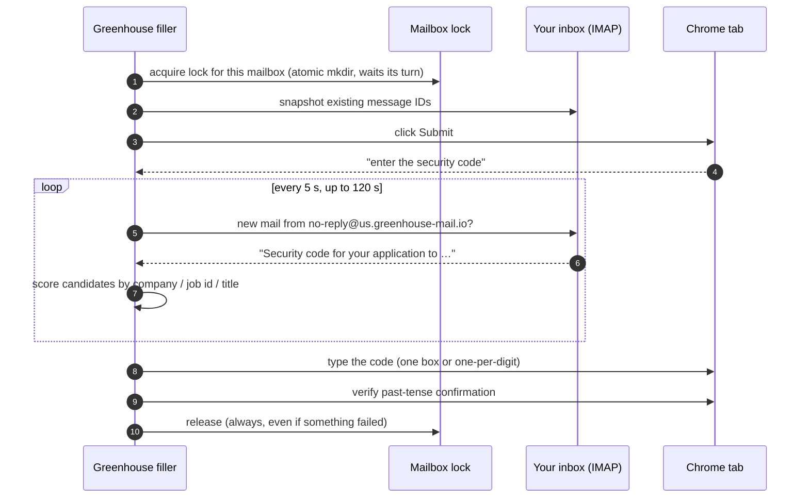

- **One application per mailbox at a time.** The lock is keyed to the mailbox, not the job. While one application waits for its code, others keep filling. They queue only for the short submit-and-read-code step.
- **Only new email counts.** The inbox is snapshotted before Submit is clicked, so an older code can't be picked up. A code that arrived up to 90 s *before* the click is kept as a fallback and used if nothing newer turns up within 45 s, to cover clock skew between your machine and the mail server.
- **The right code for the right job.** Only mail from Greenhouse's sender with the expected subject line counts. Each code is then scored against the job's company, job ID and title.
- **A rejected code is retried once** with a newer email.
- **Crash-safe.** A lock whose owner process has died, or that's older than 30 minutes, is treated as stale and cleared.
- **If the code never arrives**, the job becomes **Needs you: "Verification code never arrived — finish in the open tab"**. The form stays filled, and the code box is waiting for you.
- **The repair agent uses the same lock.** It gets an `acquire_otp_lock` tool (`otp_lock_mcp.py`) and *must* call it right before clicking Submit, so it can never take a code meant for another tab.

Lever and Ashby don't send codes through this path. If their forms show a CAPTCHA, the job is marked **Needs you**.

### 9. The repair agent

Most forms are filled entirely by ordinary code. When a fill ends in a **recoverable** failure (a validation error, a conditional question that appeared after an answer, an unconfirmed submit), the filler hands that tab to a **repair agent**: `codex exec` attached to the same Chrome through Playwright MCP. The repair agent runs only with the Codex engine; with Claude Code as the engine it is off, and a job that needs repair lands in Defects for you to finish.

- **It starts with a focus dossier.** The filler knows exactly which controls failed, with the expected value, what the control actually held, the page's own error message, and the options in the live menu. The agent is told **not** to take a full-page snapshot (4,000–10,000 tokens) when a targeted fix costs about 200.
- **It has purpose-built form tools.** `form_tools_mcp.py` provides three tools:
  - `form_state`: what's wrong, in about 200 tokens
  - `fill_fields`: sets values, with the filler's read-back check
  - `submit_and_verify`: clicks Submit and reports what the page turned into

  Before these tools existed, each generic browser call took 7.3 s, slow repairs needed 23 calls, and page snapshots made up 51% of all tool output.
- **Each agent works only in its own tab.** Every tab carries a hidden identity token (`window.__jobscan_tab__`) that survives navigation, so an agent always finds *its* tab, even among duplicates of the same job.
- **The filler has the final say.** The agent reports a verdict, then the filler runs its own submission check again. Only a confirmed submission turns the result into *submitted*.
- **You can see what it cost.** The tokens and tool calls for every repair are recorded in that application's record. The repair agent uses the Codex model chosen in Settings. It times out after 720 s by default (`JOB_AUTOMATOR_RECOVERY_TIMEOUT`), and you can turn it off with `JOB_AUTOMATOR_AI_RECOVERY=0`.

The repair procedure lives in a versioned skill file (`skills/recovery-triage/SKILL.md`) that is inserted into the agent's prompt. It isn't left for the agent to find, because an agent that skips a skill fails without any warning.

### 10. Done, history, and application records

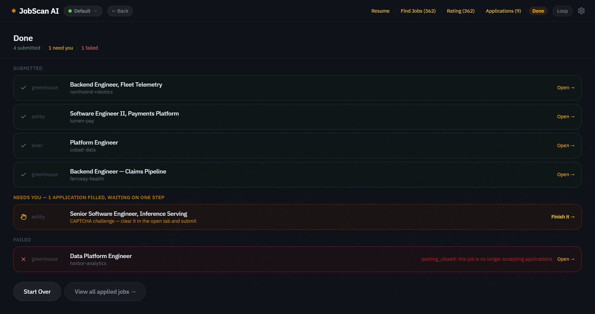

The Done screen sorts the run into **Submitted**, **Needs you** (with **Finish it →**, which brings that tab to the front) and **Failed** (with the reason).

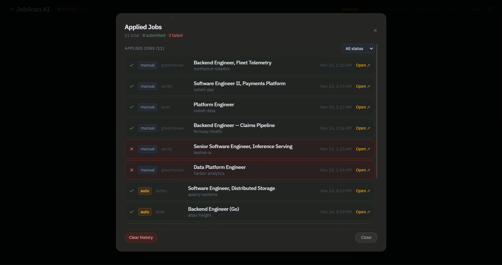

**Applied Jobs** (Settings → *View history*) keeps every application ever made, tagged `manual` or `auto` (loop mode) and filterable by status. **Open ↗** shows that application's **Q&A record**: a Markdown file with every question and the exact answer sent, the files actually uploaded (resume and cover letter, resolved from disk), field-level problems, and what the repair agent did and cost. Records are kept permanently in `jobscan/.job-automator/application-records/`.

### 11. Settings

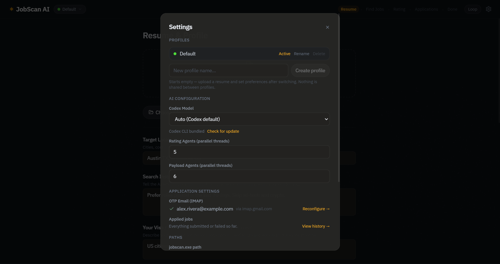

| Setting | What it does |
|---|---|
| **Profiles** | Create, rename, delete and switch personas. *A new profile starts empty: upload a resume and set preferences after switching.* Shared between profiles: the jobs database, agent counts, and the paths below. |
| **Codex Model** | With Codex: **Auto (Codex default)** or any model your Codex sign-in offers. The list comes from the Codex CLI itself. Changing the model **invalidates cached queries, ratings and answers**, so the next run really uses the new model. The change applies from the next turn, without restarting Codex. |
| **AI engine** | **ChatGPT (Codex)** or **Your Claude Code**. Switching is refused while anything runs or the loop is on. Switching engines re-runs cached searches and ratings with the new engine. |
| **Claude model** | With Claude Code: its default, or `sonnet`, `opus`, `haiku` or any model id your Claude Code accepts. Part of the cache keys, like the Codex model. |
| **Let Claude Code drive JobScan** | Lets a Claude Code session with the jobscan plugin start the safe steps and hear what happens ([section 13](#13-let-claude-code-drive-jobscan)). Off by default. |
| **Rating Agents** | Rating batches running at once (default **5**). Changes speed, not results, so it isn't part of any cache key. |
| **Payload Agents** | Application agents running at once (default **6**; loop runs use at most 5. [Why](#7-applications-how-a-form-gets-filled-and-submitted)). |
| **OTP Email (IMAP)** | Shows the connected mailbox. **Reconfigure →** to change it. |
| **Applied jobs** | **View history →**. |
| **Paths** | `jobscan.exe path`, `Python package dir (JOB_AUTOMATOR_PYTHON_DIR)`, `Job automator home (JOB_AUTOMATOR_HOME)`, and the Codex CLI or Claude Code path. They're found automatically; change them only if you've moved things. |
| **Logout** | With Codex: signs out of ChatGPT and returns to the login screen. Hidden with Claude Code, which JobScan never signs out. |

### 12. Loop mode

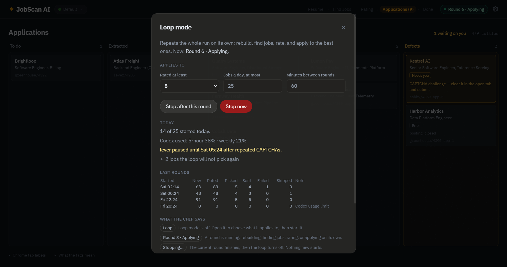

Loop mode repeats the whole run on its own, unattended, until you stop it. Open it from the **Loop** chip in the header. While it runs, the chip shows the round and stage (for example *Round 6 · Applying*).

| Setting | Default | Range | Meaning |
|---|:-:|:-:|---|
| **Rated at least** | 8 | 1–10 | Only jobs rated at or above this are picked. |
| **Jobs a day, at most** | 25 | 1–500 | Jobs the loop *starts* per local calendar day. |
| **Minutes between rounds** | 60 | 15–1440 | Minimum time between the start of one round and the start of the next. |

Changes apply from the next round. **Stop after this round** lets the current round finish. **Stop now** cancels it.

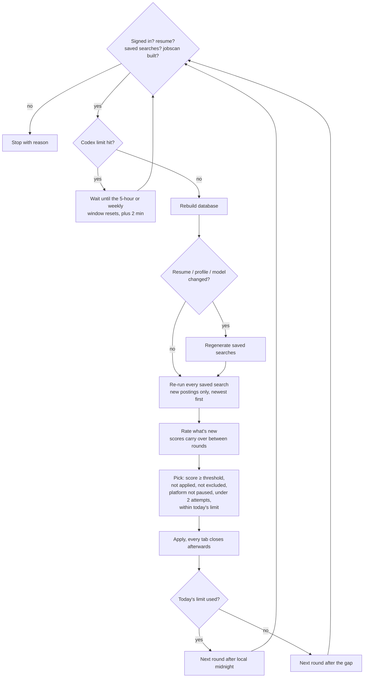

**The rules it follows** (all in `loop-policy.ts`, a pure module with its own unit tests):

- **New postings only.** Every saved search is re-run with `--since <last search day> --sort newest --limit 100`, so each round looks at what's new and doesn't re-rate the whole market.
- **Searches are regenerated only when their inputs change.** That means resume, target locations, search instructions, model or prompt version. A database rebuild alone doesn't trigger it.
- **Scores carry over.** A job rated under the same resume, profile, model and prompt keeps its score from round to round.
- **Never twice.** A job is skipped if it was already applied to, if a normal run left it open for you (you may have finished it by hand), or if it was **excluded**. Exclusions cover CAPTCHA, needs a person, posting closed, a fill cut off mid-way, and a Submit with no confirmation, since that one may have gone in. Other failures get at most **2 attempts**.
- **Paused after repeated CAPTCHAs.** Two CAPTCHAs on one platform with no submission between them pause that platform for **3 h**. The pause doubles on each repeat, up to **24 h**. Only a successful submission resets the count.
- **Waits out Codex limits.** A usage limit stops the round, and the loop sleeps until the exhausted window (5-hour or weekly) resets, plus a 2-minute margin. If the reset time is unknown, it reads "try again in…" from the error, or backs off 1 → 2 → 4 → 8 → 16 → 24 h. A job board's own `429` is never mistaken for a Codex limit.
- **Stops when the setup is broken.** A round counts as *failed* when Codex fails on every application, or when 3 or more applications all fail the way a broken setup does (for example, Chrome unreachable). **Three failed rounds in a row stop the loop.** A round that submitted anything never counts as failed. Attempts charged during a failed round are given back.
- **Time limits.** A round is capped at **3 hours** and a single fill at **25 minutes**.
- **Keeps the system from suspending the app while it runs** (Electron `powerSaveBlocker`), and releases that hold when it stops.

The panel also shows **today's count**, **Codex usage** (5-hour and weekly windows), **paused platforms**, the **jobs the loop will not pick again** (with reasons), and the **last rounds**: new, rated, picked, sent, failed, skipped, and a note such as *Codex usage limit*.

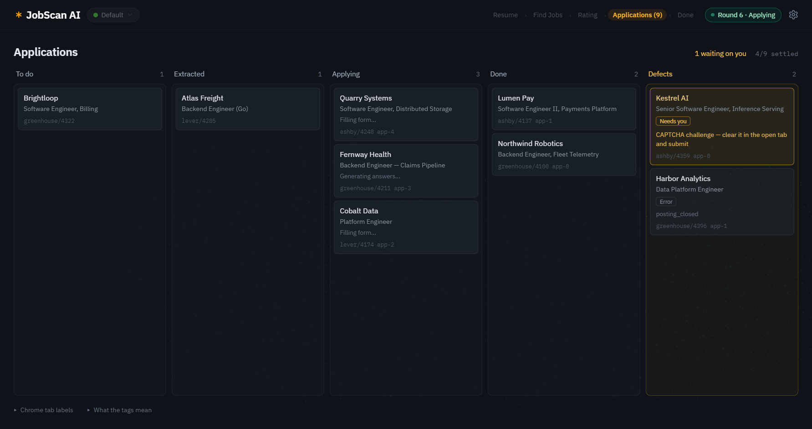

---

### 13. Let Claude Code drive JobScan

Turn on **Settings → Let Claude Code drive JobScan**, install the plugin once, and a Claude Code session can run JobScan for you while you talk to it:

```bash
claude plugin install jobscan --marketplace tarunmovva/JobScanAI   # or a local clone: --marketplace /path/to/jobscan-ai
```

Then type `/jobscan:jobscan` in Claude Code. The session can do six things, each only where and when its button in the window works: **rebuild the job database**, **cancel a rebuild**, **find jobs**, **find more** ("remote Rust roles"), **rate the jobs**, and **stop the loop**. It hears every step, every click you make in the window and every AI call as short notices, and it can leave notes that appear in a chip in JobScan's header.

What it can't do is the point:

- **It can't apply.** Choosing jobs, filling, submitting, starting the loop, changing settings and opening files stay in the window, with you.
- **It never sees a job posting.** Notices and status are numbers and fixed labels; titles, companies, links, descriptions and model replies never reach the session, so a posting can't talk to an agent that has a shell.
- **Only this computer, only this launch.** JobScan listens on `127.0.0.1` with a new token each launch, refuses anything a web page sends, and writes the token only into its own data folder. JobScan holds a single-instance lock while this is on.

The AI work itself (searches, ratings, answers) is still done by JobScan with the engine you picked, so the session only drives and watches. See [`jobscan-harness/README.md`](jobscan-harness/README.md).

## 💸 Built to save cost

All AI usage counts against your Codex allowance, so the app is designed to spend as little of it as possible at every step:

| Where | What it does | Why it matters |
|---|---|---|
| **Search** | Codex writes the queries; **SQLite FTS5 runs them locally** | Retrieval costs no tokens. Thousands of postings are filtered without a model reading any of them. |
| **Pool budget** | At most **500 jobs or 10 queries**; ~200 matches per query is the target; under 40 matches is rejected | The pool size *is* the rating bill. |
| **Top 100 per query, deduplicated, 3 per company** | Without this, 14–18% of every slice repeated a posting already seen, and one employer took 19 of 100 places | No paying to rate the same job twice, or twenty postings from one company. |
| **Applied jobs filtered before the pool** | Removed before rating, not after | No tokens spent scoring a job you can't apply to. |
| **Rating batches of 20** | One call scores 20 jobs | The system prompt and resume are sent once per 20 jobs, not once per job. |
| **4,000-character descriptions** | Reaches the requirements section for 89% of jobs | Measured trade-off: 6,000 characters would cost 22% more tokens for 8 more points of coverage. |
| **Cached stage results** | Each stage hashes its inputs and **replays** its result when nothing changed | Going Back and forward costs nothing. |
| **Rating fingerprints** | A score is reused while resume, profile, model and prompt are unchanged | Loop rounds rate only new postings. |
| **Searches regenerated only when inputs change** | A rebuild alone doesn't trigger new queries | Saves the query-writing calls every loop round. |
| **Prompt revisions in the cache key** | Bumping a prompt version invalidates only what that prompt produced | A prompt change never forces an unrelated stage to run again. |
| **Settings that change speed only aren't in cache keys** | Agent counts change speed, not output | Changing them never throws away results. |
| **Fresh read-only threads, `effort: medium`, `summary: none`** | Each task's context is isolated, and nobody pays for reasoning summaries | No context building up across tasks. |
| **Ordinary code fills first; AI only to fix** | Most forms never touch the repair agent | The expensive path runs only where it's needed. |
| **Focus dossier** | The repair agent starts with the exact broken controls | About 200 tokens instead of a 4,000–10,000-token page snapshot. |
| **Purpose-built form tools** | 3 tools replace snapshot → click → snapshot loops | Generic calls took 7.3 s each, and snapshots were 51% of all tool output. |
| **Past-tense confirmation check** | Correctly recognizes submitted pages | A missed "Thank you for applying" once triggered a 125k-token repair (and nearly a duplicate application). |
| **Empty answer set = failed turn** | Never filled from defaults | One empty answer set once led to a 67 s repair on a form whose name and email had been left blank. |
| **Codex limits waited out by reset time** | The loop sleeps until the window resets, not on a blind retry timer | No wasted retries against a limit. |
| **Midnight wait** | When today's limit is used up, the next round waits for local midnight | No hourly rebuilds when nothing can be picked. |

---

## 🧱 Built not to lose work

A submitted application can't be undone, so the app's record of it must never be lost either.

- **Recorded the moment it happens.** Each result is added to the history as soon as it's known, not at the end of the run. A crash, a cancel or closing the app never loses a record of something already submitted.
- **Interrupted runs are cleaned up.** After a restart, anything already submitted stays permanently. Everything else that was in flight (database rows stuck at `extracting`, `claimed` or `filling`) is abandoned cleanly instead of being inherited by the next run.
- **Quitting asks first.** Closing the app during a manual run asks whether to stop the run. Fillers used to keep going, and could submit, after the app had gone.
- **A cut-off fill counts as possibly sent.** If a fill is stopped after it may have submitted, the filler's result file is checked, and the job is recorded as applied when it says so. That way nobody applies twice.
- **A smooth window.** Bulk data (the job pools, about 3.3 MB each) lives in separate files next to `config.json`, and the parsed store is cached in memory. Before this, a single store read took about 85 ms on the window's thread and the board froze during runs. The history, which can't be rebuilt, stays in `config.json`, which is written atomically.
- **Tested hard.** 40 unit-test files and 4 Playwright end-to-end specs for the app, 15 Go test files (including a concurrent-claim stress test) and 26 Python test files for the filler, on Windows and macOS in CI.

---

## The `jobscan` CLI

Everything the app searches, you can search yourself. The CLI works without the app:

```bash
cd jobscan
./jobscan fetch --rebuild                 # build / refresh jobs.db
./jobscan stats                           # totals by platform, department, workplace type
./jobscan search "software engineer"      # titles only by default
./jobscan search --market usa,canada,uk \
    --title-query "('software engineer' OR 'backend engineer') AND NOT senior" \
    --key-query "'distributed systems' AND (Go OR Kafka)" \
    --exclude-key-query "clearance OR embedded" \
    --since 30d --dedupe --max-per-company 3 --format json --output matches.json
./jobscan search --remote --market remote-global --title-query "'platform engineer'" --count
```

| Command | Purpose |
|---|---|
| `fetch` | `--rebuild` (fresh database, swapped in only on success), `--force` (ignore the 2h cache), `--platform`, `--company`, `--workers`, `--quiet` |
| `search` | Every flag in the [search language](#5-find-jobs-how-searches-are-written-and-run), plus `--desc`, `--sort relevance\|newest\|oldest\|company\|title`, `--limit`, `--offset`, `--format table\|json\|csv`, `--count`, `--no-expand`, `--dedupe`, `--max-per-company`, `--raw` (raw FTS5) |
| `stats` | Database totals |
| `apply queue / extract / claim / submit / status / list` | The application queue the app drives: statuses `queued → extracting → extracted → claimed → filling → submitted / failed` |

`./jobscan --help` and `./jobscan search --help` print the full reference with many worked examples. On Windows, use `.\jobscan.exe`.

---

## Reference

### Where things are kept

| What | Where |
|------|-------|
| Settings, resume, profiles, applied-job history | `%APPDATA%\jobscan-app` (Windows), `~/Library/Application Support/jobscan-app` (macOS) |
| Job database | `jobscan/jobs.db` |
| Per-application records, the app's Chrome profile, one-time-code (OTP) secrets | `jobscan/.job-automator/` |

All of these stay on your machine and are ignored by git. To try a separate setup without touching your profile and history, give the app its own data folder:

```powershell
# Windows (PowerShell)
$env:JOBSCAN_USER_DATA_DIR = "C:\jobscan-test"
npm run dev
```

```bash
# macOS / Linux
JOBSCAN_USER_DATA_DIR=~/jobscan-test npm run dev
```

**One-time codes** sent by email: set an IMAP account with an app password on the Resume & Profile screen. The settings are saved as plain JSON in `jobscan/.job-automator/secrets/imap_config.json`. Gmail OAuth (`jobscan/setup_gmail_oauth.py`) is only used by the command-line `jobscan apply submit --otp-mailbox` path, not by the app.

### Environment variables

| Variable | Effect |
|----------|--------|
| `JOBSCAN_USER_DATA_DIR` | keep the app's settings and data in this folder instead of the usual one |
| `JOB_AUTOMATOR_SUBMIT=0` | fill forms without ever submitting them |
| `JOB_AUTOMATOR_CHROME_PATH` | the Chrome executable to use |
| `JOBSCAN_SKIP_SETUP=1` | skip `scripts/setup.mjs` (you build the CLI and manage Python yourself) |
| `JOB_AUTOMATOR_AI_RECOVERY=0` | turn off the repair agent (failed fills stay failed) |
| `JOB_AUTOMATOR_RECOVERY_TIMEOUT` | seconds per repair attempt (default 720) |
| `JOB_AUTOMATOR_OTP_TIMEOUT_SECONDS` | how long to wait for an emailed code (default 120) |
| `JOBSCAN_CODEX_BIN` | the Codex CLI to run, when it isn't found on its own (Settings has the same) |
| `JOBSCAN_HARNESS_FILE` | for the jobscan plugin: the `harness.json` to use instead of the app's data folder |

Set a variable in the terminal you start the app from, then run `npm run dev` in that same terminal:

| Shell | Example |
|-------|---------|
| Windows PowerShell | `$env:JOB_AUTOMATOR_SUBMIT = "0"` |
| Windows Command Prompt | `set "JOB_AUTOMATOR_SUBMIT=0"` |
| macOS / Linux | `export JOB_AUTOMATOR_SUBMIT=0`, or for one command only: `JOB_AUTOMATOR_SUBMIT=0 npm run dev` |

A variable set this way lasts until that terminal is closed. To clear it sooner: `Remove-Item Env:JOB_AUTOMATOR_SUBMIT` (PowerShell), `set JOB_AUTOMATOR_SUBMIT=` (Command Prompt), `unset JOB_AUTOMATOR_SUBMIT` (macOS / Linux).

### Tests

```bash
cd jobscan-app
npm run test:unit      # typecheck + unit tests
npm run test:e2e       # builds, then drives the app with Playwright (in its own Electron profile)
# Real runs with your own Claude Code (they spend your plan; never in CI):
npx playwright test --config scripts/claude-smoke/playwright.config.ts smoke          # searches + ratings
npx playwright test --config scripts/claude-smoke/playwright.config.ts orchestrator   # a Claude Code session drives it

cd ../jobscan
go test ./...
# Python tests: pytest, plus the headless browser some of them launch (the app itself uses your Chrome)
.venv/bin/python -m pip install pytest
.venv/bin/python -m playwright install chromium-headless-shell
.venv/bin/python -m pytest tests
```

On Windows the environment's Python is `.venv\Scripts\python`:

```powershell
cd ..\jobscan
go test ./...
.venv\Scripts\python -m pip install pytest
.venv\Scripts\python -m playwright install chromium-headless-shell
.venv\Scripts\python -m pytest tests
```

A few tests skip on a fresh clone: they read local data (`jobscan/.job-automator/`, `jobscan/jobs.db`) that only exists after you have used the app.

### Regenerating the screenshots

The images in `docs/screenshots/` come from a Playwright script that launches the real app on a throwaway data folder. It fills each screen with sample data and never calls Codex, `jobscan` or Chrome:

```bash
cd jobscan-app
npm run build
npx playwright test --config scripts/readme-screenshots/playwright.config.ts
```

### Repository layout

```
jobscan-ai/
├── jobscan/                         Go CLI + Python form filler
│   ├── cmd/                         fetch · search · stats · apply (queue, extract, claim, submit)
│   ├── internal/
│   │   ├── fetcher/ parser/         concurrent board download; Greenhouse / Lever / Ashby parsers
│   │   ├── db/                      schema, FTS5, spelling expansion, dedupe, apply queue
│   │   ├── market/                  location → market classifier and registry
│   │   └── queryparser/             the Boolean query language
│   ├── data/                        the ~13,700 board lists
│   └── job_application_automator/   extractors, fillers, OTP, repair agent, form tools
└── jobscan-app/                     Electron + React desktop app
    ├── electron/                    pipeline, rating engine, loop conductor & policy, Codex client/updater
    ├── src/                         screens and components
    └── tests/                       unit (node --test) and e2e (Playwright)
```

### Status

- Developed on Windows. CI ([.github/workflows/ci.yml](.github/workflows/ci.yml)) builds and tests on Windows and macOS on every push. The macOS end-to-end run is informational until it has passed once. Reports from Mac users are welcome.
- `npm run dist` (packaged installers) does not bundle the CLI and Python correctly yet; use `npm run dev`.

## License

MIT. See [LICENSE](LICENSE).
